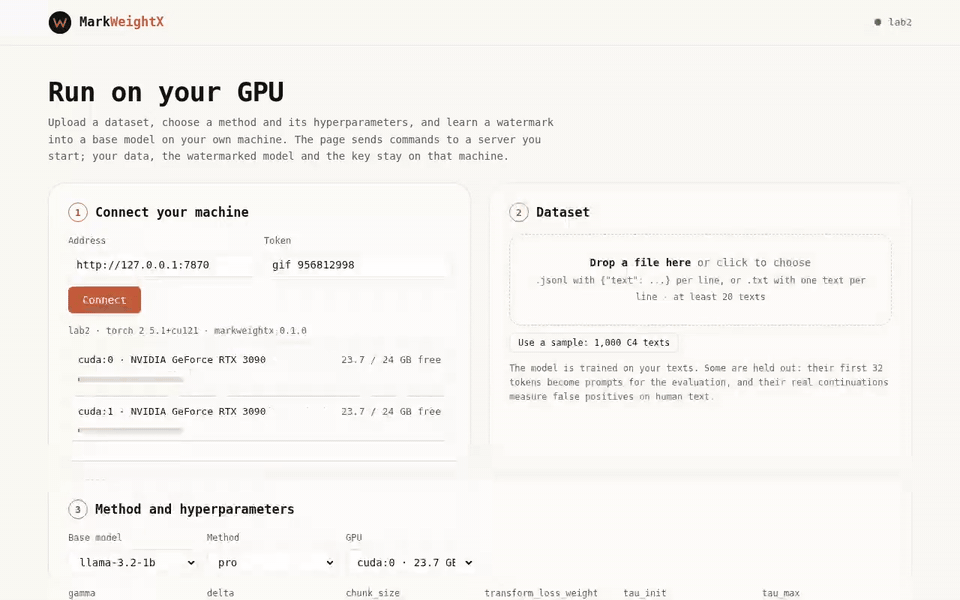

<p align="center">
  <picture>
    <source media="(prefers-color-scheme: dark)" srcset="docs/static/logo-dark.png">
    
  </picture>
</p>

<p align="center"><strong>A toolkit for watermarking open-weight language models</strong></p>

<p align="center">
  <a href="https://claude.ai/artifact/2WJtrDVjpgCsJeE1bSmEwp">
    
  </a>
  <a href="https://arxiv.org/abs/2510.23891">
    
  </a>
  <a href="https://colab.research.google.com/github/UCF-ML-Research/MarkWeightX/blob/main/notebooks/run_on_colab.ipynb">
    
  </a>
</p>

---

MarkWeightX trains a watermark into the weights of an open model, so that text from the model can be traced back
to it with a private key, even after others quantize, prune, merge or fine-tune the released weights. One set of
calls embeds, edits and detects for every method: PRO, our NeurIPS 2026 method, 12 decoding-time watermarks from
MarkLLM learned into the weights, and GaussMark.

<p align="center">
  
</p>

## 🧰 Install

```bash
git clone https://github.com/UCF-ML-Research/MarkWeightX.git && cd MarkWeightX
pip install -e .                    # the markweightx package and command
bash scripts/install_deps.sh        # MarkLLM at a pinned commit, for the markllm-* methods
python exp/prepare_data.py          # once: C4 text for training, prompts and human continuations
```

Python 3.10+ and a CUDA GPU for training and sampling. Without a GPU, the
[Colab notebook](https://colab.research.google.com/github/UCF-ML-Research/MarkWeightX/blob/main/notebooks/run_on_colab.ipynb)
runs the same thing on a free T4.

<details>
<summary>Optional</summary>

- Tests: `pip install -e ".[test]" && pytest -q tests -m "not slow"` (about a minute on CPU).
- Storage: runs and keys go under `~/.markweightx`; set `MWX_RUNS`, `MWX_KEYS` or `MARKLLM_DIR` to move them.
  Back up the key store: a lost key cannot be recovered.
- Gated base models such as `meta-llama/*` need `huggingface-cli login`.

</details>

## 🚀 How to use

**1. Mark a model.** The owner trains the mark into the weights and keeps the key; `calibrate` sets the detection
threshold on the unmarked base model.

```bash
markweightx embed --base llama-3.2-1b --watermark pro      # prints {"release": ..., "key": ...}
markweightx calibrate KEY --base llama-3.2-1b
```

**2. Edit it the way others will.** Fine-tune, merge, prune or quantize the release, then sample from it.

```bash
markweightx modify RELEASE --edit finetune:steps=300 --out edited/
markweightx generate edited/ --prompts prompts.jsonl --out texts.jsonl
```

**3. Detect.** A text and the key give a p-value per text; asking a suspect model prompts gives one verdict for the model.

```bash
markweightx detect texts.jsonl --key KEY
markweightx verify edited/ --key KEY --prompts prompts.jsonl --sequential --budget 40
```

**4. Or from a web page.** Upload a dataset, pick a method and its hyperparameters, and train on this machine's GPUs.

```bash
markweightx serve                   # prints an address with a token; open it in a browser
```

<details>
<summary>The same flow in Python</summary>

```python
import markweightx as mwx

release, key = mwx.embed("llama-3.2-1b", "pro")              # model to release + private key
key = mwx.calibrate(key, "llama-3.2-1b")                      # threshold on the base model's own texts
edited = mwx.modify(release, "finetune:steps=300")            # a downstream user's edit
hits = mwx.detect(mwx.generate(edited, prompts), key)         # one p-value per text
verdict = mwx.verify_model(edited, key, prompts, sequential=True, budget=40)   # one verdict for the model
```

`examples/quickstart.py` runs this end to end on one GPU in a few minutes.

</details>

## 🖼️ Run a demo

One command runs a whole experiment: prepare the data, learn the mark into the weights, generate, detect, apply the
edits, measure quality, and write `report.json` (each step resumes after an interruption).

```bash
markweightx run configs/demos/taming.yaml       # images: Taming Transformers + WMAR's green list (needs MWX_WMAR_DIR)
markweightx run configs/demos/medgemma.yaml     # image + question -> answer: MedGemma 1.5
markweightx run configs/demos/geopt.yaml        # physics: GeoPT aircraft fields (needs MWX_GEOPT_DIR)
markweightx run configs/demos/agent.yaml        # a ReAct agent on Llama-3.1-8B-Instruct
markweightx run configs/demos/geopt.yaml --smoke   # a few steps and samples, to check the setup
```

Each config holds the settings of the run shown on the website (`tests/test_demo_configs.py` checks them against the
original run files). Detect on files directly: `markweightx detect images/ --model taming --key <release> --release
<release>` for a directory of PNGs, `--model geopt` for an `.npz` with `points`, `field` and `condition`.

## 📦 What it ships

```
markweightx/
├── cli.py · api.py     embed · calibrate · modify · generate · rewrite · detect · verify · bench · serve
├── schemes/            pro · markllm (12 learned decoding watermarks) · gaussmark
├── edits/              weights: finetune · merge · prune · quantize   text: synonym · word_deletion
├── check.py            the tests a new method must pass
├── bench.py            every method through the same edits and the same detector
└── serve.py · app.html the run page
configs/                training recipe, one config per method, benchmark arenas
exp/                    experiment scripts behind the benchmark
notebooks/              run_on_colab.ipynb
```

## 📊 Methods and results

| Method | How the mark gets in | Detector needs |
|---|---|---|
| `pro` (ours) | PRO's watermark policy, learned into the weights | text, key |
| `markllm-<x>-d` | a MarkLLM decoding watermark, learned into the weights: KGW, Unigram, SWEET, EWD, MorphMark, DIP, Unbiased, SynthID, EXP, EXPEdit, ITSEdit, PF | text, key (SWEET, EWD, Unbiased also the base model) |
| `gaussmark` | a keyed perturbation written into one weight matrix | text, key, the base model's gradients |

Results of the PRO paper on LLaMA-3-8B, under every edit: **[LEADERBOARD.md](LEADERBOARD.md)**. To run the same
benchmark on your own methods:

```bash
markweightx bench configs/arena/1b.yaml --dry-run      # what is done, what would run
markweightx bench configs/arena/1b.yaml
```

## 🧩 Extending

| To add | Where it goes |
|---|---|
| A watermark method | one file from `markweightx new-scheme`, passed by `markweightx check` |
| A weight edit (attack on the weights) | a function with `@mwx.register_edit` in your own file, loaded with `--plugin` |
| A text edit (attack on the text) | a function with `@mwx.register_text_edit` in the same kind of file |
| A dataset or domain | `exp/prepare_data.py --dataset <HF id or .jsonl>`, then `MWX_DATA=<file>` |
| A base model | `--base <HF id or local dir>` (Llama-style causal LMs); pin it in `BASES` |
| A benchmark arena | a yaml under `configs/arena/`; plugin edits go under `plugins:` |

A method is one class: `setup` builds its state from the key, `target_logits` is the signal the model learns, and
`score` reads it back from text.

<details>
<summary>Example</summary>

```bash
markweightx new-scheme my-mark            # writes my_mark.py
markweightx check --adapter my_mark.py    # the adapter checks, minutes on CPU
markweightx embed --base llama-3.2-1b --watermark my_mark.py
```

```python
@mwx.register_scheme
class MyMark(mwx.Scheme):
    name = "my-mark"
    def setup(self, model, tokenizer, device, key=None): ...   # the key
    def target_logits(self, input_ids, logits): ...            # the signal the model learns
    def score(self, text): ...                                 # the detector
```

</details>

`examples/my_edits.py` adds one weight edit and one text edit, and `configs/arena/plugins_example.yaml` benchmarks
them; the reference's [Extending MarkWeightX](docs/REFERENCE.md#extending-markweightx) walks through all five.
The [reference](docs/REFERENCE.md) covers every command and parameter, keys, what a detector needs, the checks,
the benchmark and how `verify_model` decides.

## 📝 Citation

```bibtex
@inproceedings{xue2026pro,
  title     = {PRO: Enabling Precise and Robust Text Watermark for Open-Source LLMs},
  author    = {Xue, Jiaqi and Zhao, Yifei and Al Ghanim, Mansour and Gao, Shangqian and
               Sun, Ruimin and Lou, Qian and Zheng, Mengxin},
  booktitle = {Advances in Neural Information Processing Systems (NeurIPS)},
  year      = {2026}
}
```
