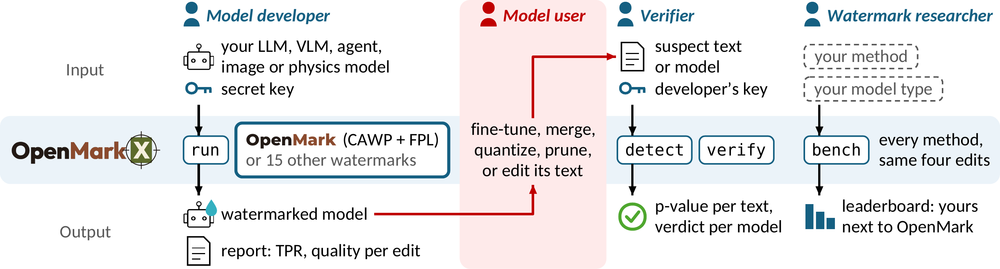

<p align="center">
  <picture>
    <source media="(prefers-color-scheme: dark)" srcset="docs/static/logo-dark.png">
    
  </picture>
</p>

<h3 align="center">OpenMark: Enabling Precise and Robust Text Watermark for Open-Source LLMs</h3>

<p align="center">
  <b>Project</b>&nbsp; · &nbsp;
  <a href="https://loopleap-lab.github.io/OpenMarkX/">Website</a> ·
  <a href="https://arxiv.org/abs/2510.23891">Paper</a> ·
  <a href="#citation">Cite</a>
  <br>
  <sub>The arXiv version is titled "PRO"; OpenMark is the camera-ready name.</sub>
  <br>
  <b>Get started</b>&nbsp; · &nbsp;
  <a href="#quick-start">Quick start</a> ·
  <a href="https://colab.research.google.com/github/loopleap-lab/OpenMarkX/blob/main/notebooks/run_on_colab.ipynb">Colab</a> ·
  <a href="LEADERBOARD.md">Leaderboard</a>
  <br>
  <b>Reference</b>&nbsp; · &nbsp;
  <a href="#documentation">Docs</a> ·
  <a href="docs/methods.md">Methods</a> ·
  <a href="docs/models.md">Your model</a> ·
  <a href="docs/FAQ.md">FAQ</a> ·
  <a href="ROADMAP.md">Roadmap</a>
</p>

## About

**OpenMarkX** is the toolkit released with OpenMark (NeurIPS 2026). It learns a watermark into the weights of a
model before release, tests the watermark under the edits a user can make to the weights, and detects it later with
the developer's secret key. Language, vision-language, agent, image and physics models all run through
`openmarkx run`. `embed` and `verify`, and the Python API, are text-only for now; `detect` also takes Taming images
and GeoPT fields. OpenMark was called PRO and the toolkit MarkWeightX; the old names still work.

<p align="center">
  <a href="docs/static/overview.pdf"></a>
</p>

**Overview of OpenMarkX.** Each column is one role, with its input above the OpenMarkX band and its output below. A
model developer watermarks a model with OpenMark (the default method, `openmark`) or another method before release; a model user (red) may then
fine-tune, merge, quantize or prune it, or edit its text; a verifier with the developer's key tests a suspect text
or model; and a watermark researcher compares methods under the same modifications with `bench`, on a
leaderboard of their own runs (the paper's results are in [LEADERBOARD.md](LEADERBOARD.md)).

Users of an open-source LLM control both decoding and the weights, so a watermark added at decoding time can be
switched off. An open-source watermark has to be produced by the model itself under standard decoding and survive
edits to the weights. Learning a decoding watermark into the weights leaves two problems:

- **Learnability.** The model may not fully learn the watermark pattern, so what it generates and what the detector
  expects drift apart.
- **Robustness.** The learned watermark fades after fine-tuning, merging, quantization or pruning.

OpenMark addresses both:

- **A watermark policy trained jointly with the LLM**, so the watermark the LLM learns matches the detection pattern.
  The paper calls this the Co-Adaptive Watermark Policy (CAWP).
- **A perturbation-aware regularizer**, so the watermark stays detectable after weight-level edits. The paper calls
  this Forgotten Perturbation-aware Learning (FPL).

The paper (abstract; Section 4, "Detectability and Quality Analysis", with the per-model points in the appendix
table "Per-model PPL comparison") reports that, on three open-source LLMs, OpenMark reaches 0.92 TPR at 1% FPR while
lowering perplexity by 20.5% on average relative to the strongest prior method (Gu et al.-KGW). On LLaMA-3-8B after SLERP merging (t = 0.5), it keeps
0.57 TPR at 5% FPR, where prior methods keep at most 0.34. [LEADERBOARD.md](LEADERBOARD.md) has the paper's
LLaMA-3-8B tables, and [How OpenMarkX works](docs/architecture.md) shows the layers and the run pipeline. The
closest base in this toolkit is `llama-3.1-8b`; the paper's LLaMA-3-8B is not in `BASES`, but
`--base meta-llama/Meta-Llama-3-8B` loads it by repo id.

## Installation

```bash
git clone https://github.com/loopleap-lab/OpenMarkX.git
cd OpenMarkX
pip install -e .                    # add the vision extra for images: pip install -e ".[vision]"
bash scripts/install_deps.sh        # MarkLLM at a pinned commit, for the markllm-* methods
```

OpenMarkX needs Python 3.10 or later and a CUDA GPU. Without a GPU, the
[Colab notebook](https://colab.research.google.com/github/loopleap-lab/OpenMarkX/blob/main/notebooks/run_on_colab.ipynb)
runs on a free T4. Runs and keys go under `~/.openmarkx`; back up the keys, since a lost key cannot be recovered.
The [user guide](docs/user-guide.md) has the other options.

`pip install` alone gives the library without a corpus. `embed`, `calibrate`, the `finetune` edit and the prompt
helper read a tokenized corpus that `python exp/prepare_data.py` makes from a clone of this repository. It streams
C4 from Hugging Face, so it needs internet access.

## Quick start

A language model, step by step:

```bash
python exp/prepare_data.py                                  # once: C4 text and held-out prompts
python -c "import json; from openmarkx.models import load_tokenizer; from openmarkx.sampling import eval_prompts; \
open('prompts.jsonl', 'w').writelines(json.dumps({'text': p}) + '\n' for p in eval_prompts(load_tokenizer('llama-3.2-1b'), n=100))"
openmarkx embed --base llama-3.2-1b --watermark openmark    # the paper's method; prints {"release": RELEASE, "key": KEY}
openmarkx calibrate KEY --base llama-3.2-1b                 # the detection threshold, on the unmarked model
openmarkx modify RELEASE --edit finetune:steps=300 --out edited/
openmarkx generate edited/ --prompts prompts.jsonl --out texts.jsonl
openmarkx detect texts.jsonl --key KEY                      # one p-value per text
openmarkx verify edited/ --key KEY --prompts prompts.jsonl  # one verdict for a suspect model
```

`RELEASE` and `KEY` are the two fields that `embed` prints. `openmark` is the paper's method: the watermark policy
is trained with the model (CAWP) and every step adds forgetting-perturbation training (FPL), about three times the
compute per step of `openmark-frozen` (the same policy kept frozen, no FPL). For a quick first run, use
`--watermark openmark-frozen` or `gaussmark`. The second line writes 100 held-out C4 prompts from the
data that `exp/prepare_data.py` made; any `.jsonl` file with one `{"text": ...}` per line, or a `.txt` file with one
prompt per line, works too.

The same in Python:

```python
import openmarkx as omx

prompts = ["The history of the city begins", "A good recipe for bread"]
release, key = omx.embed("llama-3.2-1b", "openmark")
key = omx.calibrate(key, "llama-3.2-1b")
edited = omx.modify(release, "finetune:steps=300")
hits = omx.detect(omx.generate(edited, prompts), key)
```

`openmarkx serve` runs the text recipe from a web page. The [user guide](docs/user-guide.md) covers the rest: every
command and parameter, keys, configs and reproducing the paper.

## Demos

One command runs a whole experiment from a config: it learns the mark into the weights, checks outputs with the key,
applies the config's edits and writes `report.json`. A stopped run picks up where it stopped.

<p align="center">
  
</p>

```bash
openmarkx run configs/demos/geopt.yaml       # physics: GeoPT aircraft fields
openmarkx run configs/demos/taming.yaml      # images: Taming Transformers
openmarkx run configs/demos/medgemma.yaml    # medical VQA: MedGemma 1.5
openmarkx run configs/demos/agent.yaml       # a ReAct agent on Llama-3.1-8B-Instruct
```

| Demo | Method | What it needs | GPU | Imprint time of the site's run |
|---|---|---|---|---|
| `geopt`, `geopt_colearn` | `ripple` | a [GeoPT](https://github.com/Physics-Scaling/GeoPT) checkout in `OMX_GEOPT_DIR` with `checkpoints/craft_geopt_8layers.pt`; the AirCraft data in `$OMX_DEMO_DATA/geopt/aircraft_npys` | one GPU; a small field model. `geopt` writes the mark in closed form (no training steps); `geopt_colearn` trains 3,000 steps. Both then fine-tune the release as edits | `geopt`: 7 s (edits: 2 min) |
| `taming` | `wmar` | a WMAR checkout in `OMX_WMAR_DIR`; the Taming checkpoint directory in `TAMING`; the `vision` extra | one GPU; a full fine-tune of Taming's GPT in two phases (800 and 1,000 steps); FID for quality | 55 min |
| `medgemma` | `openmark-frozen` | the gated `google/medgemma-1.5-4b-it` (accept its terms on Hugging Face); data from `exp/med/prepare.py` and `exp/med/distill_data.py`; the `vision` extra | one GPU; LoRA on a 4B model, 1,500 steps. No edits (`edits: []`) | 1 h 51 min |
| `agent` | `openmark-frozen` | data from `exp/agent/prepare.py` and `exp/agent/distill_data.py` | one GPU; LoRA on an 8B model, 1,500 steps. No edits (`edits: []`) | 36 min |

The times are the `imprint` step of the runs shown on the website (`docs/static/runs/*/viewer.json`). They leave
out data preparation: `exp/med/distill_data.py` and `exp/agent/distill_data.py` generate the base model's own
answers to train on, and are GPU jobs of their own.

Runs go to `~/.openmarkx/runs/demos/<name>/` (`$OMX_RUNS/demos/<name>/`). `OMX_DEMO_DATA` defaults to
`~/.openmarkx/runs`, where the `exp/agent` and `exp/med` scripts write. Add `--smoke` for a few steps, to check the
setup. Publish `~/.openmarkx/runs/demos/<name>/release/`; the secret key is not in it.

Check a file from another model type later with its key:

```bash
openmarkx detect field.npz --model geopt --key ~/.openmarkx/runs/demos/geopt/release
openmarkx detect images/ --model taming --key ~/.openmarkx/runs/demos/taming/release
```

## Methods

| Method | How the mark gets in |
|---|---|
| `openmark` (ours) | OpenMark, the paper's method: a watermark policy trained with the model (CAWP), with FPL; `openmark-frozen` keeps the policy fixed |
| `markllm-<x>-d` | one of 12 MarkLLM decoding watermarks (KGW, SynthID, ...), learned into the weights |
| `gaussmark` | a keyed perturbation written into one weight matrix |
| `wmar`, `ripple` | a green list over image tokens; a keyed pattern over a predicted field |

[Methods](docs/methods.md) describes each method, the checks a method must pass, and how to add one.

## Watermarking your own model

Another causal language model needs one line: pass `--base` a Hugging Face repo id or a local directory, or add a
line to `BASES` in `openmarkx/paths.py` to pin its revision ([user guide](docs/user-guide.md#another-base-model)).

A field model, such as a neural PDE surrogate, plugs into the `geopt` adapter through one small class named in the
config. With the `ripple` mark it runs through every step of `openmarkx run` and through `openmarkx detect`:

```yaml
# run.yaml
model: {name: geopt, factory: "my_field:MyField", ckpt: null, data: null}
scheme: {name: ripple, params: {eps: 0.05}}
imprint:
  phases:
    - {steps: 400, lr: 1.0e-3, trainable: full}
detect: {fpr: 0.01, null: wrong_keys, n_null: 20}
edits: ["finetune:steps=20,lr=1e-4"]
quality: rel_l2
out: runs/my_field
```

```bash
PYTHONPATH=. openmarkx run run.yaml       # PYTHONPATH=. lets the adapter import my_field.py
```

The class gives the model, one forward call per case, the data splits and a normalizer. The
[tutorial](docs/models.md) has a runnable `my_field.py`, shows how to pair it with your own mark, and walks through
the GeoPT and Taming adapters in `openmarkx/models/` as worked examples. Running a new adapter type end to end is
on the [roadmap](ROADMAP.md).

## Benchmark

`openmarkx bench configs/arena/1b.yaml` scores methods under quantization, pruning, merging and fine-tuning, the
same kinds of edit as the paper (the toolkit's own settings; see [docs/benchmark.md](docs/benchmark.md)). It
writes a leaderboard of your own runs. [Benchmark](docs/benchmark.md) describes the edits and the protocol, and
[LEADERBOARD.md](LEADERBOARD.md) has the paper's results.

## Documentation

| document | what it covers |
|---|---|
| [User guide](docs/user-guide.md) | installing; keys; `openmarkx run` and its configs; every command and parameter; the Python API; reproducing the paper |
| [How OpenMarkX works](docs/architecture.md) | the model adapters, methods, edits, detection and benchmark layers; the run pipeline; repository layout |
| [Methods](docs/methods.md) | the watermark methods; the checks a method must pass; adding a method |
| [Watermarking your own model](docs/models.md) | a field model behind the `geopt` adapter, your own mark, and the GeoPT and Taming adapters as worked examples |
| [Benchmark](docs/benchmark.md) · [Leaderboard](LEADERBOARD.md) | the edits, the protocol and the results |
| [FAQ](docs/FAQ.md) | common questions and troubleshooting |
| [Roadmap](ROADMAP.md) · [Changelog](CHANGELOG.md) | what is done and planned; what changed in each release |

## License

Apache License 2.0. See [LICENSE](LICENSE).

## Citation

If you use OpenMarkX or OpenMark in your research, please cite the [paper](https://arxiv.org/abs/2510.23891). You
can also [download the BibTeX entry](docs/static/openmark.bib).

```bibtex
@inproceedings{xue2026openmark,
  title     = {{OpenMark}: Enabling Precise and Robust Text Watermark for Open-Source {LLMs}},
  author    = {Xue, Jiaqi and Zhao, Yifei and Al Ghanim, Mansour and Gao, Shangqian and
               Sun, Ruimin and Lou, Qian and Zheng, Mengxin},
  booktitle = {Advances in Neural Information Processing Systems (NeurIPS)},
  year      = {2026},
  url       = {https://arxiv.org/abs/2510.23891}
}
```
