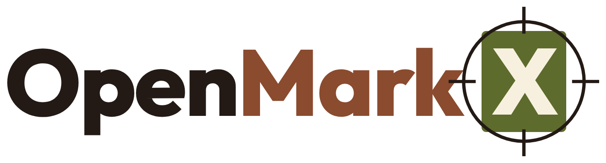
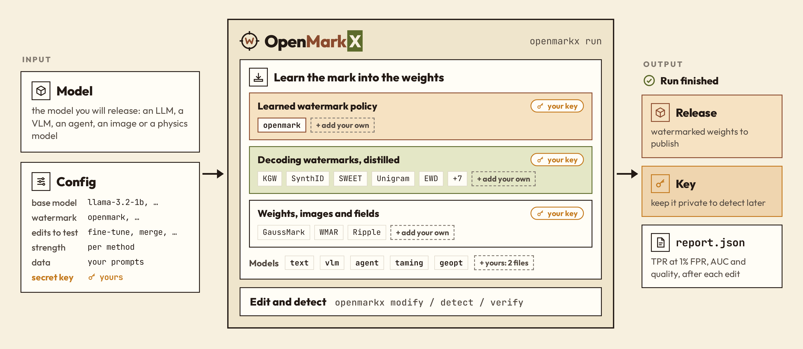
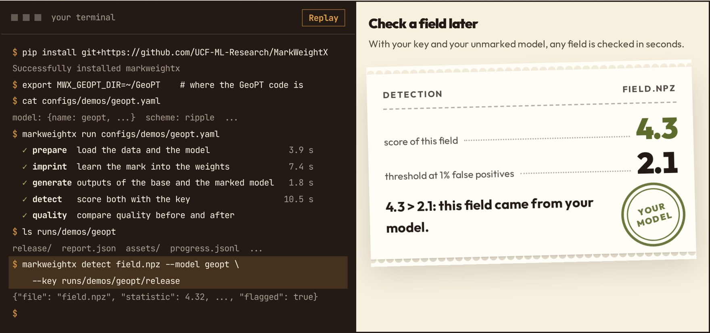

<p align="center">
  <picture>
    <source media="(prefers-color-scheme: dark)" srcset="docs/static/logo-dark.png">
    
  </picture>
</p>

<p align="center"><strong>Watermarks for open-weight generative models</strong></p>

<p align="center">
  <a href="https://claude.ai/artifact/2WJtrDVjpgCsJeE1bSmEwp">
    
  </a>
  <a href="https://arxiv.org/abs/2510.23891">
    
  </a>
  <a href="https://colab.research.google.com/github/UCF-ML-Research/OpenMarkX/blob/main/notebooks/run_on_colab.ipynb">
    
  </a>
</p>

---

OpenMarkX trains a watermark into the weights of a model you release. Your private key then traces what the model
generates, and edited copies of it, back to you. Language, vision-language, image, agent and physics models all go
through the same commands.

<p align="center">
  <picture>
    <source media="(prefers-color-scheme: dark)" srcset="docs/static/overview-dark.png">
    
  </picture>
</p>

## Install

```bash
git clone https://github.com/UCF-ML-Research/OpenMarkX.git && cd OpenMarkX
pip install -e .
bash scripts/install_deps.sh        # MarkLLM at a pinned commit, for the markllm-* methods
```

Python 3.10+ and a CUDA GPU. Without a GPU, the
[Colab notebook](https://colab.research.google.com/github/UCF-ML-Research/OpenMarkX/blob/main/notebooks/run_on_colab.ipynb)
runs on a free T4. Runs and keys go under `~/.openmarkx`; back up the keys, a lost key cannot be recovered.

OpenMarkX was called MarkWeightX. Code, keys and runs made under the old names (`import markweightx`, the
`markweightx` command, `--watermark pro`, `MWX_*` variables, `~/.markweightx`) keep working.

## Get started

One command runs a whole experiment: it learns the mark into the weights, checks the outputs with the key, applies
the edits and writes `report.json`. A stopped run picks up where it stopped.

```bash
openmarkx run configs/demos/geopt.yaml       # physics: GeoPT aircraft fields (needs OMX_GEOPT_DIR)
openmarkx run configs/demos/taming.yaml      # images: Taming Transformers (needs OMX_WMAR_DIR)
openmarkx run configs/demos/medgemma.yaml    # medical VQA: MedGemma 1.5
openmarkx run configs/demos/agent.yaml       # a ReAct agent on Llama-3.1-8B-Instruct
```

<p align="center">
  
</p>

Add `--smoke` for a few steps, to check the setup. Publish `runs/demos/<name>/release/`; the key is not in it.

Check a file later with the key:

```bash
openmarkx detect field.npz --model geopt --key runs/demos/geopt/release
openmarkx detect images/ --model taming --key runs/demos/taming/release
openmarkx detect texts.jsonl --key KEY
```

<details>
<summary>Language models, step by step</summary>

```bash
python exp/prepare_data.py                                    # once: C4 text and prompts
openmarkx embed --base llama-3.2-1b --watermark openmark    # prints {"release": ..., "key": ...}
openmarkx calibrate KEY --base llama-3.2-1b                 # the detection threshold, on the unmarked model
openmarkx modify RELEASE --edit finetune:steps=300 --out edited/
openmarkx generate edited/ --prompts prompts.jsonl --out texts.jsonl
openmarkx detect texts.jsonl --key KEY                      # one p-value per text
openmarkx verify edited/ --key KEY --prompts prompts.jsonl  # one verdict for a suspect model
```

The same in Python:

```python
import openmarkx as omx

prompts = ["The history of the city begins", "A good recipe for bread"]
release, key = omx.embed("llama-3.2-1b", "openmark")
key = omx.calibrate(key, "llama-3.2-1b")
edited = omx.modify(release, "finetune:steps=300")
hits = omx.detect(omx.generate(edited, prompts), key)
```

`openmarkx serve` runs the same from a web page.

</details>

## Watermark your own model

A new model takes two small files and a config; OpenMarkX itself does not change.

```
my_project/
├── my_model.py    how to load and run the model, and what one output unit is
├── my_mark.py     how the key shifts each unit, and how to score an output
└── run.yaml       points at both
```

`openmarkx run run.yaml` then learns the mark into the weights and checks new outputs, as above. The GeoPT and
Taming adapters in `openmarkx/models/` are worked examples.

## Methods and results

| Method | How the mark gets in |
|---|---|
| `openmark` (ours) | OpenMark: a watermark policy, learned into the weights |
| `markllm-<x>-d` | one of 12 MarkLLM decoding watermarks (KGW, SynthID, ...), learned into the weights |
| `gaussmark` | a keyed perturbation written into one weight matrix |
| `wmar`, `ripple` | a green list over image tokens; a keyed pattern over a predicted field |

Results under quantization, pruning, merging and fine-tuning are in **[LEADERBOARD.md](LEADERBOARD.md)**.
`openmarkx bench configs/arena/1b.yaml` runs the same benchmark on your methods.

## Documentation

- [Website](https://claude.ai/artifact/2WJtrDVjpgCsJeE1bSmEwp): what it does, results and demos; its developer guide
  shows how to add a method, an edit or a model.
- [docs/REFERENCE.md](docs/REFERENCE.md): every command and parameter, keys, the checks a method must pass, the
  benchmark.

## Citation

```bibtex
@inproceedings{xue2026openmark,
  title     = {OpenMark: Enabling Precise and Robust Text Watermark for Open-Source LLMs},
  author    = {Xue, Jiaqi and Zhao, Yifei and Al Ghanim, Mansour and Gao, Shangqian and
               Sun, Ruimin and Lou, Qian and Zheng, Mengxin},
  booktitle = {Advances in Neural Information Processing Systems (NeurIPS)},
  year      = {2026}
}
```
